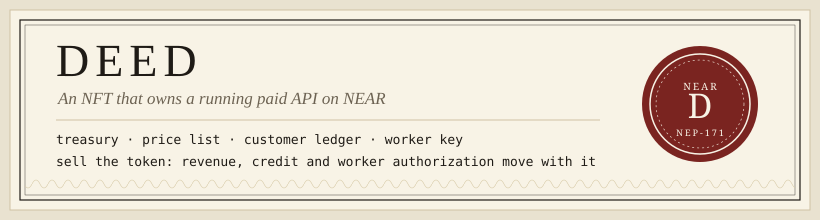

<p align="center"></p>

# Deed

Deed is an NFT that owns a running paid API. Each token is one business: its treasury, price
list, customer ledger and worker key live in a NEAR sub-account that the token controls.
Selling the token moves the business to the buyer while customers keep calling it.

The demo business is a durable webhook relay that agents pay per delivery. In the demo the
buyer is itself an agent: it reads the vault's on-chain revenue, computes payback, and buys.

Testnet only. Built for the NEAR hackathon (November 2026), tracks `nfts` and `business`.

## The problem

Small paid APIs are hard to sell. The buyer has to trust the seller's revenue numbers, take
over payment accounts, migrate customers and change servers, and the seller can drain the
cash or keep billing until the last minute. So most small API businesses are never sold, they
are shut down.

On NEAR the business itself can live on chain: the money, the prices, the customer balances and
the right to bill. Then a sale is one token transfer, the revenue history is public, and the new
owner takes over with one key rotation.

## How it works

```
 seller / buyer --- NEP-171 token ---> deed contract ---- owner push (epoch) ----> vault <slug>.<deed>
                    built-in sale       (registry,          lock / unlock            treasury, price,
                    ft_transfer_call     factory, sale,                              customer ledger,
                    {"buy": ...}         dynamic NFT)  <---- on_stats -------------  worker key
                                                                                        ^
 customers (SDK) -- NEP-413 signed request --> worker (gateway + relay + charger) -------+ charge,
                <-- 402 / receipt / proofs --       signs as the vault with a            signed as the
                                                    function-call key limited to charge   vault
```

1. `mint` on the deed contract creates the vault sub-account `<slug>.<deed>` in one batch
   (create account, deploy the vault code, init) and mints the token only after that succeeded.
   The vault has no full-access key, ever.
2. Customers prepay credit in the payment token (`ft_transfer_call` to the vault) and call the
   worker with NEP-413 signed requests. Unknown or unfunded customers get HTTP 402 with the exact
   call to make.
3. The worker accepts a delivery, signs an obligation receipt, delivers with retries, signs a
   proof of every attempt, and charges the vault in batches with its function-call key. Charges
   move credit to revenue within each customer's balance and daily cap.
4. The token holder withdraws revenue. Listing the token locks the vault (no withdraw, no key
   rotation, no price change). A buyer pays through `ft_transfer_call` on the payment token; the
   deed moves the token, pushes the new owner to the vault and pays the seller.
5. From the next charge on, revenue belongs to the buyer and the seller's withdraw reverts. The
   buyer starts a worker and rotates the worker key and endpoint in one transaction. The old
   worker sees it on chain, hands its open obligations to the new endpoint and exits.

More detail: [docs/DESIGN.md](docs/DESIGN.md) (design and threat model),
[docs/CONTRACTS.md](docs/CONTRACTS.md) (every method and invariant),
[docs/DEMO.md](docs/DEMO.md) (the demo step by step), [docs/SECURITY.md](docs/SECURITY.md).

## Try it

Requirements: Node 22 or newer and npm. For the contracts also Rust with the
`wasm32-unknown-unknown` target and `cargo-near` 0.22.

| Do | See |
|---|---|
| `npm ci && bash scripts/check.sh` | Contract wasm builds, 38 contract unit tests, 19 sandbox integration tests (near-workspaces), 31 Node tests (sdk, worker, agents) and the web build all pass. `SKIP_SANDBOX=1` skips the sandbox tests. |
| `npm run build && node agents/dist/src/buyer.js --account <any testnet account> --dry-run` | The buyer agent reads every listing on `deed2.deedlab.testnet`, prints revenue, gas, cash, payback and its checks, and says whether it would buy. Read only. The demo deed `relay-10300721` is listed for 5 tUSDC; the agent skips it because its worker (on the demo machine's localhost) does not answer. |
| `npm run dev -w web`, open http://127.0.0.1:7650 | The web app with every deed, its live figures and its dynamic NFT certificate. Connect a testnet wallet to buy, list, withdraw, rotate the worker or manage your relay credit. Open a deed to see its earnings history: each holder, what it earned and paid out while they held it, with the transactions as proof. `npm run build -w web` writes a static site to `web/dist/` (relative paths, works on GitHub Pages). |
| Open `deployments/testnet.json`, section `demo` | The last full demo run on testnet: every step with its transaction link. A copy of the key links is below. |
| `bash scripts/demo-testnet.sh` (needs funded testnet accounts, see below) | The whole story on testnet in about 6 minutes: worker A and traffic, revenue ticking, listing, the buyer agent buying, the seller's withdraw reverting, worker B taking over, pending deliveries delivered, the buyer withdrawing. It prints a link at every step and stops every process it started. |
| `node agents/dist/src/withdraw-xchain.js --vault <vault> --to eth:usdc --recipient 0x...` | A NEAR Intents 1Click dry quote for paying vault revenue out to another chain, and the exact `withdraw` call it would make. Nothing is sent. |
| `bash scripts/smoke-testnet.sh` | The contract-only story on testnet (mint, charge, list, buy, rotate) with assertions. |

The demo needs four testnet accounts with keys in the near-cli legacy keychain
(`~/.near-credentials/testnet/<account>.json`): a seller with about 3.5 NEAR (each run mints a
new deed for 2.88 NEAR) and a buyer, alice and bob with about 1 NEAR each. Create them with
`near account create-account sponsor-by-faucet-service <name>.testnet autogenerate-new-keypair save-to-legacy-keychain network-config testnet create`
and pass them as `DEMO_SELLER`, `DEMO_BUYER`, `DEMO_ALICE`, `DEMO_BOB`. tUSDC is minted for
them automatically (anyone can mint up to 1,000 per call).

Running a worker yourself: `node worker/dist/src/cli.js --vault <vault> --network testnet --port 7601`.
It reads price, endpoint, worker key and payment token from chain and refuses to start unless
its key file holds the vault's registered worker key.

## NEAR features used

| Feature | Where |
|---|---|
| NEP-171 core, NEP-177 metadata, NEP-181 enumeration | `contracts/deed/src/nft.rs`, `contracts/deed/src/views.rs` |
| Dynamic NFT metadata (on-chain SVG certificate built from pushed stats) | `contracts/deed/src/svg.rs`, `contracts/vault/src/hooks.rs` (`push_stats`) |
| Sub-accounts created by a contract (one vault per token, deployed in one batch) | `contracts/deed/src/mint.rs` |
| Function-call access keys (worker key limited to `charge` on the vault, added and deleted by the vault itself) | `contracts/vault/src/owner.rs` (`set_worker`), `worker/src/vault-chain.ts` |
| NEP-297 events (`deed_*`, `vault_*`, NEP-171 events) | `contracts/deed/src/events.rs`, `contracts/vault/src/events.rs` |
| NEP-141 fungible token, NEP-145 storage, NEP-148 metadata (tUSDC) | `contracts/tusdc/src/lib.rs` |
| NEP-141 `ft_transfer_call` as the payment path (customer credit, deed purchase) | `contracts/vault/src/customer.rs`, `contracts/deed/src/sale.rs`, `sdk/src/client.ts` |
| NEP-413 signed messages for API authentication | `sdk/src/nep413.ts`, `worker/src/auth.ts` |
| NEAR Intents 1Click API (dry quotes: fund a purchase from another chain, pay out revenue to another chain) | `agents/src/oneclick.ts`, `agents/src/buyer.ts`, `agents/src/withdraw-xchain.ts` |
| NEAR Connect wallet connector | `web/src/wallet.ts` |

Not used: gas keys (NEP-611) and global contracts (NEP-591). Both are on the roadmap; see
"Limits".

## What moves with the token

Enforced by the contracts, so it moves without trusting the seller:

- **Treasury.** Withdrawable revenue stays in the vault and belongs to whoever holds the token.
- **Price list.** The price per call; increases take effect only after a 24-hour notice.
- **Customer ledger.** Every customer's prepaid credit, daily cap and sequence number. Customer
  credit is never withdrawable by the owner; customers can always take it back after the refund
  delay (10 minutes).
- **Worker authorization.** The only key on the vault is the worker's function-call key. The
  token holder replaces it; the old key is deleted in the same step.

Not enforced, and said plainly:

- **The hosting.** Servers, domains and uptime are off chain. After a sale the seller's worker
  keeps serving (for the buyer's revenue) until the buyer rotates the key.
- **The image hash** in the vault is a published claim about the worker code, not verified.
  TEE attestation of workers is roadmap.
- **Delivery.** A worker can take a paid delivery and not deliver it. Signed receipts and
  proofs make that visible, caps and refunds limit it.
- **The deed account on testnet** still has a full-access key so the code can be redeployed.
  On mainnet it must be locked or put behind a DAO. See [docs/SECURITY.md](docs/SECURITY.md).

## Testnet deployment

| | |
|---|---|
| Deed contract | [`deed2.deedlab.testnet`](https://testnet.nearblocks.io/address/deed2.deedlab.testnet) |
| Payment token (tUSDC, test only) | [`tusdc.deedlab.testnet`](https://testnet.nearblocks.io/address/tusdc.deedlab.testnet) |
| Code hashes | in [`deployments/testnet.json`](deployments/testnet.json); `vault_code_hash()` on the deed returns the hash every vault runs |

### Recorded demo run (30 October 2026)

Business `relay-10300721`, vault
[`relay-10300721.deed2.deedlab.testnet`](https://testnet.nearblocks.io/address/relay-10300721.deed2.deedlab.testnet).
All steps are in `deployments/testnet.json` under `demo`.

| Step | Transaction |
|---|---|
| Seller mints the deed; the deed creates the vault sub-account (no access key) | [EsT2qz…](https://testnet.nearblocks.io/txns/EsT2qzHDRHDi7HSGE4NDjnmTNUYKQgWKxpxJGC6Lw4de) |
| Seller registers worker key A and the endpoint in one transaction | [8dACB7…](https://testnet.nearblocks.io/txns/8dACB7GjrDmBTjgV38APYLZmJnwXnJU3vUoYqrJjXfm8) |
| Customer gets 402, pays credit with `ft_transfer_call` | [Hdmu4y…](https://testnet.nearblocks.io/txns/Hdmu4ywEGTwmJ2iByWdEPyULGAPpJZ66JbnDmhzCHZdi) |
| Worker A charges a batch, signed as the vault with its function-call key | [HetKsZ…](https://testnet.nearblocks.io/txns/HetKsZQtaGVNnd4s5peenQmShPfMsscFi2urNwCNmq5C) |
| Stats pushed; the NFT certificate updates | [FVpCRd…](https://testnet.nearblocks.io/txns/FVpCRdfVBzQJZS79PgzhKTto3oN4Td6rn22x8ptHdoQY) |
| Seller withdraws revenue | [HtgTDN…](https://testnet.nearblocks.io/txns/HtgTDNKEDBS62yfobyZpLR5fjvoAo3wzTKQ59m25UnAU) |
| Seller lists for 3 tUSDC (the vault locks) | [EQZJTr…](https://testnet.nearblocks.io/txns/EQZJTrTbtaxWcrwxxodPQiT3hzZJjL2j6RrxiM8qCwYg) |
| Buyer agent computes payback 3.2 days and buys | [5XSBW6…](https://testnet.nearblocks.io/txns/5XSBW6r7QeR3NWoofNT1z7wumm7b3jwEBoHFQEmcmhfy) |
| Seller's withdraw after the sale reverts (`only the deed owner`) | [7x4Kqr…](https://testnet.nearblocks.io/txns/7x4Kqrzn34AyTvL1Si5tLWLwk15b3GFYBnLfJinvfjHR) |
| Buyer rotates worker key and endpoint in one transaction | [Bebore…](https://testnet.nearblocks.io/txns/BeboreCLtSNvYvHYA4L1zn71oBDEas1TNqbWaFi2u5pN) |
| Worker B charges with the new key (including obligations it took over) | [5SRMwT…](https://testnet.nearblocks.io/txns/5SRMwTioRavZWHeVw2S9TQFcBtuvfRDjMVvsZWbT7KDJ) |
| Buyer withdraws revenue | [HsmHGP…](https://testnet.nearblocks.io/txns/HsmHGP2HyhxctSzF9UNjXwLPAcRHuCVbEUeNq6gH1kyv) |

Off chain in the same run: worker A noticed the rotation, handed 21 open obligations to
worker B (B charged 4 of them as new, the rest were already charged by A) and exited by itself.
Alice and bob had 96 and 95 deliveries accepted, all delivered, 70 receipts each signed by
worker A and the rest by worker B. The buyer agent's 1Click dry quote for funding the 3 USDC
from Ethereum came back at 3.035842 USDC.

## Limits

- Testnet only, with a test token. Nothing here has been audited; the contract review in
  [docs/SECURITY.md](docs/SECURITY.md) is a self-review.
- One worker per vault at a time, one charge transaction at a time (a single access key nonce).
  NEP-611 gas keys would allow parallel charge lanes; they are not used yet because a gas key
  holds its own NEAR balance that the vault would have to fund and refill.
- Each vault is a full contract deployment (about 2.3 NEAR of storage). NEP-591 global
  contracts would make vaults cheap at scale, but publishing one costs about 10 NEAR per 100 KB
  once, so for a handful of deeds per-vault deployment is cheaper.
- Revenue history can be inflated by an owner paying their own business. The buyer agent looks
  at customer count and the history window, not only totals, but cannot rule it out.
- The buyer agent spreads revenue over at least one day; for a vault that is minutes old (as in
  the demo) the payback estimate is optimistic, and the agent says so.
- Deliveries are at least once: after a handover a delivery can reach its target twice. It is
  never charged twice.
- The 1Click integration only asks for dry quotes. 1Click has no testnet, and this project never
  sends mainnet transactions.

## Roadmap

- Mainnet with native USDC and the deed account locked (no full-access key) or DAO-controlled.
- TEE-attested workers, so the image hash becomes a verified fact instead of a claim.
- NEP-591 global contracts for vault code once there are many deeds.
- An uptime bond the owner posts in the vault, slashed when signed receipts show unserved work.
- NEP-611 gas keys for parallel charge lanes.

## Credits

Third-party libraries, each under its own licence:

- [near-sdk-rs and near-contract-standards](https://github.com/near/near-sdk-rs) (MIT or Apache-2.0)
- [near-workspaces-rs](https://github.com/near/near-workspaces-rs) and [near-sandbox-rs](https://github.com/near/near-sandbox-rs) (MIT or Apache-2.0), tests only
- [cargo-near](https://github.com/near/cargo-near) (MIT or Apache-2.0), build tool
- [near-api-js](https://github.com/near/near-api-js) (MIT and Apache-2.0)
- [@noble/curves](https://github.com/paulmillr/noble-curves), [@noble/hashes](https://github.com/paulmillr/noble-hashes), [@scure/base](https://github.com/paulmillr/scure-base) (MIT)
- [@hot-labs/near-connect](https://github.com/hot-dao/near-selector) (MIT)
- [Vite](https://github.com/vitejs/vite) (MIT) and [TypeScript](https://github.com/microsoft/TypeScript) (Apache-2.0), build tools
- [NEAR Intents 1Click API](https://docs.near-intents.org/) for dry quotes

All code in this repository was written for this project.

## Licence

MIT. See [LICENSE](LICENSE).
